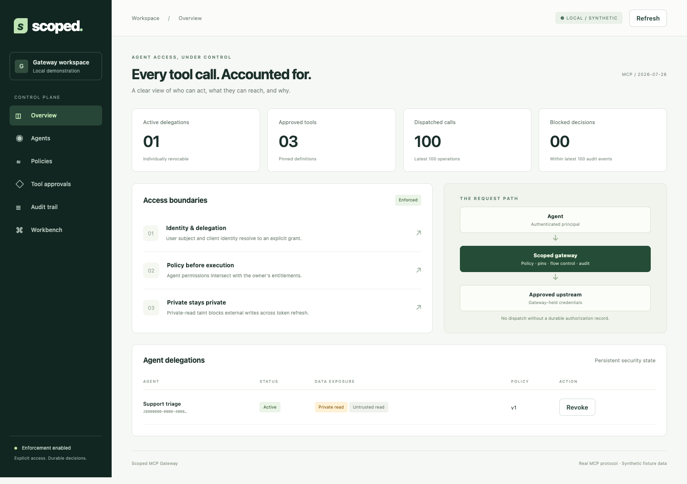
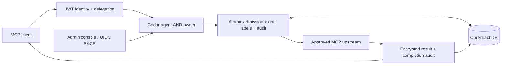

# Scoped MCP Gateway

A policy enforcement gateway for agents that use repository tools. It checks delegated permissions before each call, keeps upstream credentials on the server, blocks external writes after private data exposure, and records authorization decisions in CockroachDB.



## Features

- JWT identity mapped to explicitly provisioned agent delegations.
- Cedar policies that evaluate both agent permissions and owner entitlements.
- Persistent private-data exposure tracking across calls and token refreshes.
- Approved tool definitions pinned by their canonical SHA-256 hashes.
- Durable operation records, encrypted results, and cached replay of completed operations.
- Append-only audit events with a hash chain and an audit verifier.
- An administration console with delegations, a policy editor and simulator, tool approvals, audit history, and an MCP workbench.
- A local MCP fixture with synthetic repositories and an OIDC demonstration using Keycloak.
- Structured logs, trace-context propagation, health endpoints, and Prometheus metrics.

## Tech stack

| Component     | Technology                                               |
| ------------- | -------------------------------------------------------- |
| Runtime       | Node.js 22, TypeScript, Express                          |
| Protocol      | Model Context Protocol, official TypeScript SDK          |
| Authorization | Cedar WASM, JWT/JWKS, OAuth authorization code with PKCE |
| Storage       | CockroachDB, PostgreSQL wire protocol                    |
| Encryption    | AES-256-GCM, HMAC argument commitments                   |
| Console       | React, Vite                                              |
| Tests         | Vitest, fast-check, Playwright                           |
| Packaging     | Docker, Docker Compose, GitHub Actions                   |

## Run locally

Install Node.js 22.23.2 and Docker, or use the included script to install a local CockroachDB binary. npm 11.6.2 is recommended for dependency changes.

```sh
npm ci
npm run build
bash scripts/local-db.sh
npm run demo
```

To use Docker for the database, replace `bash scripts/local-db.sh` with:

```sh
docker compose up -d --wait db
```

Open [localhost:3000](http://localhost:3000) and select **Open demo workspace**. The demo starts an MCP upstream with synthetic repository content, creates local signing keys, seeds three approved tools, and runs the gateway with a restricted database role. Local keys and database state are stored under the ignored `.local/` directory.

In **Workbench**, read issues from `demo/public`, read a file from `demo/private` with `get_file_contents`, then try `create_issue` against `demo/public`. The gateway denies the write after the private read. **Audit trail** displays the decisions and provides a hash-chain check.

Ctrl-C stops the gateway and fixture. A database started by the demo stops with it; a separately started database stays running. State persists between runs.

## Development

Keep the demo running, then start the console development server:

```sh
npm run console:dev
```

Open [localhost:5173](http://localhost:5173). Vite proxies API and MCP requests to the local gateway.

```sh
npm run check         # types, lint, unit/property tests, production builds
npm run format:check  # formatting
```

Run database integration tests against a dedicated test database:

```sh
.local/bin/cockroach sql --insecure --host=127.0.0.1:26267 \
  --execute='CREATE DATABASE IF NOT EXISTS gateway_test;'
TEST_DATABASE_URL='postgresql://root@127.0.0.1:26267/gateway_test?sslmode=disable' \
  npm run test:integration
```

With the demo running and Google Chrome installed:

```sh
npm run test:browser
```

Additional scripts exercise attack sequences against the synthetic fixture and compare direct fixture calls with the complete gateway path:

```sh
npm run redteam
npm run bench
```

Reports are written to `.local/reports/`. For the Keycloak login demo and its browser tests, follow the [runbook](docs/runbook.md).

## Architecture



The gateway commits operation intent and audit records before dispatching an upstream call. Completion stores the encrypted result and its audit event together. A repeated operation ID with matching inputs replays a completed result. Recovery records expired operations as unknown for operator inspection.

Supported tools are `list_issues`, `get_file_contents`, and `create_issue`, namespaced by connector. Connectors use the local fixture or the GitHub remote MCP adapter. Operators provision identity bindings, credentials, and policies, then approve tool definitions in the console.

## Configuration and operations

[`.env.example`](.env.example) lists the runtime configuration. The demo supplies local defaults and generates its keys automatically. For a configured deployment, provide JWT issuer/JWKS settings, the resource URL, restricted database credentials, and independent encryption and HMAC keys.

The container runs as a non-root user. Production startup enforces HTTPS identity/resource URLs, verified database TLS, restricted runtime permissions, and externally supplied keys. The [runbook](docs/runbook.md) covers provisioning, database grants, identity setup, recovery, retention, and deployment configuration.

## Documentation

- [Architecture](docs/architecture.md)
- [API](docs/api.md)
- [Operations runbook](docs/runbook.md)
- [Threat model](docs/threat-model.md)
- [Security](SECURITY.md)

## License

[MIT](LICENSE)
